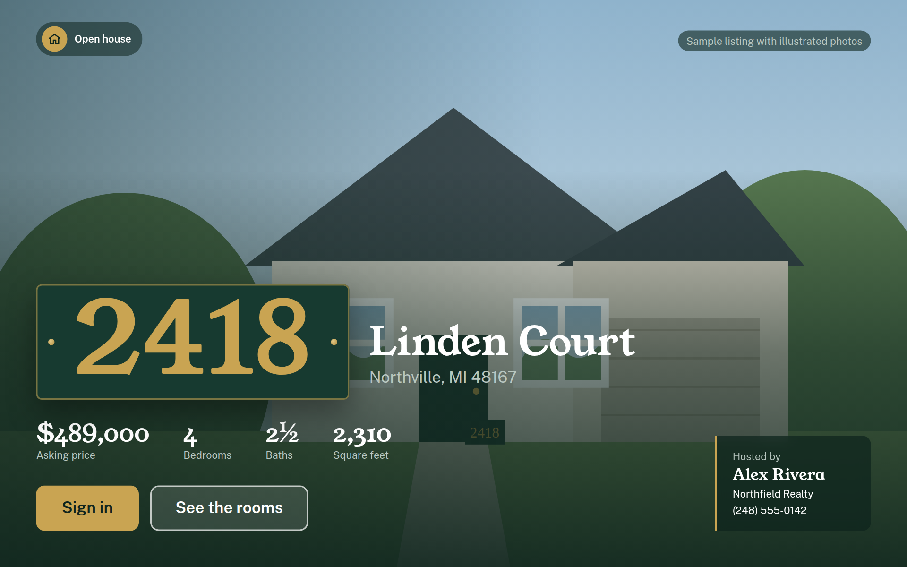
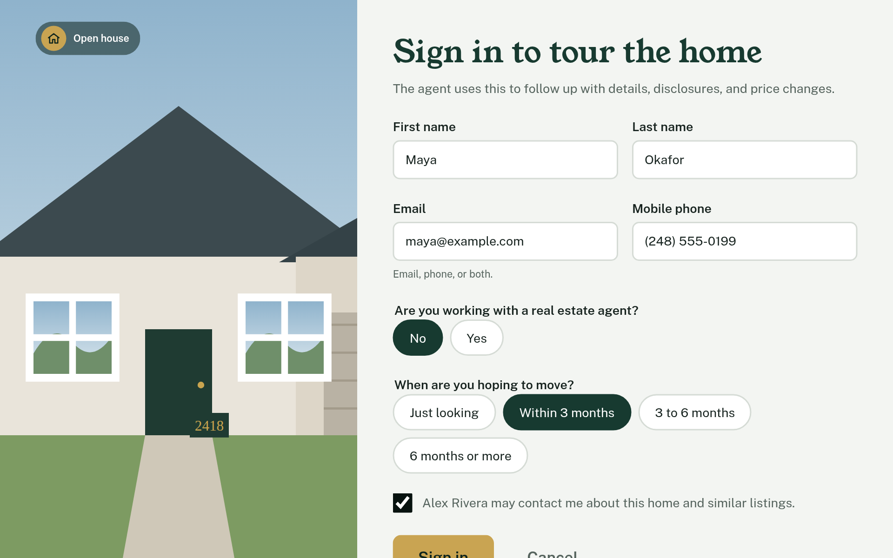
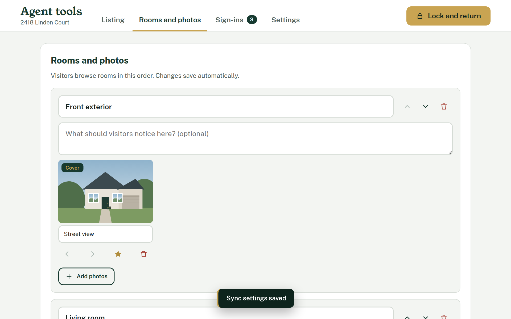

# Open House Display

A real estate agent I know was still collecting open house sign-ins on a paper clipboard. So I built him a tablet app instead: visitors sign in at the door and flip through the house room by room, and he gets every lead in a spreadsheet afterwards.



| Sign-in | Room tour |
| --- | --- |
|  |  |
| **Agent: rooms and photos** | **Agent: sign-ins** |
|  |  |

## Features

- Sign-in form built for touch (name, email/phone, has an agent?, buying timeline)
- Swipeable room-by-room photo tour
- Resets to the welcome screen after inactivity, so the next visitor can't see the last one's info
- PIN-locked agent mode (hold "Open house" in the corner): edit the listing, add photos from the camera or gallery, export sign-ins to CSV
- Works offline and syncs to a small server when Wi-Fi is available
- Kiosk mode so visitors can't leave the app

## How it works

```
Android tablet (Kotlin WebView shell)
  └── web app (plain JS, IndexedDB)  ──HTTPS──▶  sync server (Node/Express + SQLite)
```

- `web/` – the app itself. Plain HTML/CSS/JS, no framework or build step, so it's fast on older tablets and I could test it in a desktop browser.
- `android/` – a thin Kotlin wrapper that hosts the web app and handles what a web page can't: kiosk mode, keeping the screen on, the photo picker, and sharing the CSV.
- `server/` – optional. Collects sign-ins from one or more tablets.

A few things I had to think through:

- **Open houses have bad Wi-Fi.** Every sign-in is saved to the tablet first and uploaded later with retry and backoff, so a dropped connection never loses a lead.
- **No duplicates.** Each sign-in gets an ID on the tablet and the server ignores repeats, so retries are safe.
- **Shared validation.** The tablet and the server import the same validation and CSV code, so they always agree on what a valid sign-in is.
- **Privacy.** The PIN is stored only as a salted hash with lockout after wrong guesses. CSV exports are escaped so a name like `=HYPERLINK(...)` can't run as a formula in Excel. The WebView can only load the app's own pages, and API keys are compared in constant time.

## Running it

Requires Node 22.13+.

```bash
cd web && npm install && npm run dev        # http://localhost:5173
```

Set a PIN, then pick **Sample listing** to try it with a fake house.

To test syncing, start the server in another terminal and enter its URL and key under agent **Settings**:

```bash
cd server && npm install
API_KEY=local-development-key-1234567890 DATABASE_FILE=dev.db npm start   # http://localhost:8787
```

**Android:** open `android/` in Android Studio, or run `./gradlew assembleDebug`. From the emulator the server is at `http://10.0.2.2:8787`.

**Deploying the server:** there's a Dockerfile (build from the repo root). Put it behind HTTPS. All settings are in [`server/.env.example`](server/.env.example).

## Tests

```bash
cd web && npm test              # unit + screen tests (Vitest)
cd web && npm run test:e2e      # end-to-end, including a real sync to the server (Playwright)
cd server && npm test           # API: auth, duplicate uploads, CSV export
cd android && ./gradlew testDebugUnitTest
```

GitHub Actions runs all of them on every push and attaches a debug APK.

## What I'd add next

- Multiple listings per tablet for back-to-back open houses
- Pushing leads straight into a CRM
- Play Store release

## License

MIT. Fonts are under the SIL Open Font License.
