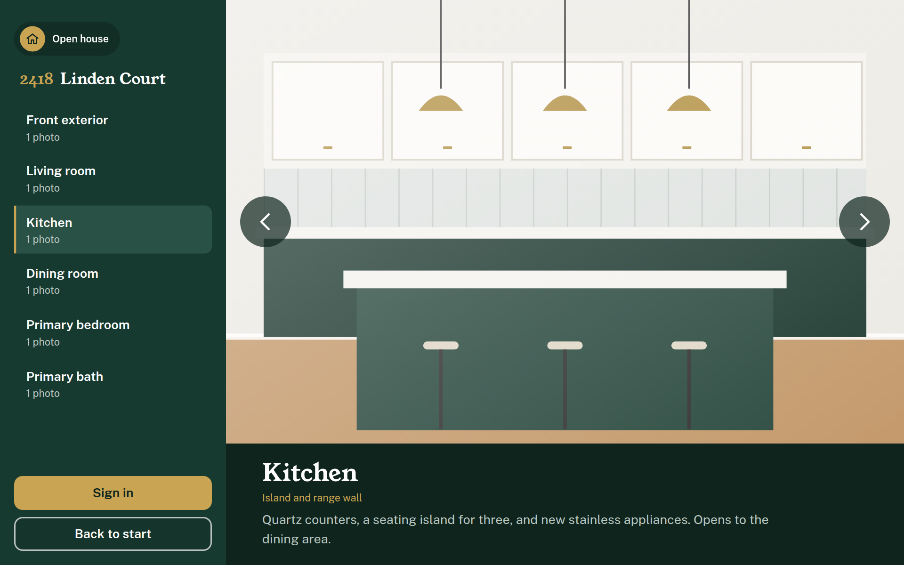
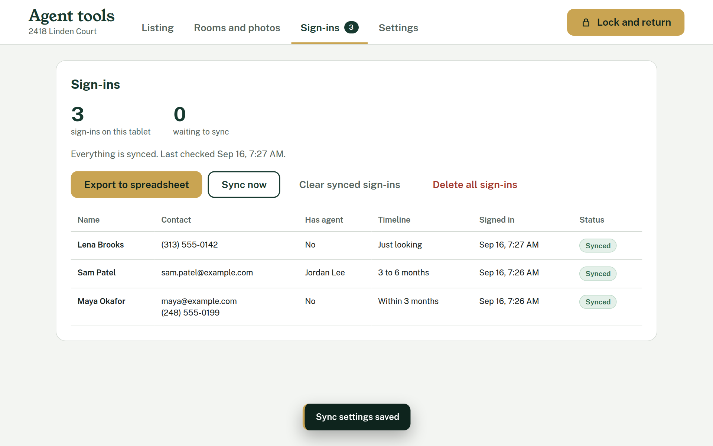
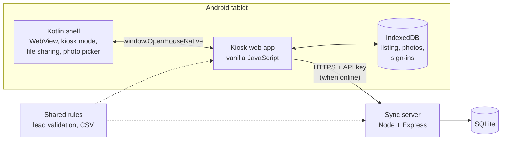

# Open House Display

A sign-in and listing kiosk for real estate open houses. An agent props an Android tablet by the front door; visitors sign in and browse the home room by room; every sign-in is saved on the tablet and backed up to the agent's own server.

Built for a working real estate agent who was collecting open house sign-ins on paper.


| Visitor sign-in | Room-by-room tour |
| --- | --- |
|  |  |

| Agent: rooms and photos | Agent: sign-ins, synced to the server |
| --- | --- |
|  |  |

## What it does

### For visitors

- Full-screen welcome with the home's photo, address, price, and key facts
- A sign-in form sized for touch: name, email and/or phone, whether they already have an agent, buying timeline, and consent to be contacted
- A room-by-room photo tour with swipe, arrow buttons, and captions
- Returns to the welcome screen after inactivity and clears any half-typed personal information

### For the agent

Press and hold "Open house" in the corner, then enter a PIN.

- Edit the listing details and cover photo
- Add, reorder, and caption rooms and photos straight from the tablet's gallery or camera
- See every sign-in with its sync status, export them to a spreadsheet, or clear them
- Connect a sync server, change the PIN, set the idle timeout, and pin the app to the screen (kiosk mode)

## How it's built



The repository has three parts:

| Folder | What it is |
| --- | --- |
| [`web/`](web) | The kiosk app itself: plain HTML, CSS, and JavaScript modules with no build step. Runs in any modern browser and, unchanged, inside the Android app. |
| [`android/`](android) | A thin Kotlin app (`com.serafimovski.openhousedisplay`) that hosts the web app and adds what a web page can't do: share a CSV file, pin the screen, keep the display awake, and open the photo picker. |
| [`server/`](server) | An optional sync server that receives sign-ins from one or more tablets and stores them in SQLite. |

### Design decisions

**Offline first.** Open houses happen in empty homes with unreliable Wi-Fi. A sign-in is written to the tablet's local database *before* anything else happens, so a dropped connection can never lose a visitor. A background scheduler uploads unsent sign-ins when the server is reachable, retrying with growing delays (30 seconds up to 15 minutes) while it isn't.

**Retries can't create duplicates.** Each sign-in gets a random ID on the tablet. The server stores rows with `INSERT OR IGNORE` on that ID, so if an upload succeeds but the response is lost and the tablet sends the same batch again, nothing is duplicated. If the server rejects a sign-in as invalid, the tablet marks it "needs attention" instead of retrying it forever.

**One set of rules on both sides.** Sign-in validation and CSV formatting live in dependency-free modules in `web/site/js/core/`. The tablet imports them directly and the server imports the very same files, so the two can never disagree about what a valid sign-in is.

**A web UI inside a native shell.** The interface is web code so it can be developed and tested quickly in a desktop browser (including with Playwright), while the Kotlin layer stays small: under 350 lines covering only platform features. The Android build packages `web/site` as app assets directly, so there is no copy step to forget.

**No framework.** The app is a handful of screens on a tablet that may be several years old. Plain JavaScript modules keep startup fast and leave nothing to keep upgrading.

### Security and privacy

Visitors type personal information into a device left in a stranger's home, so the defaults are conservative:

- **The agent PIN is never stored.** Only a salted PBKDF2-SHA256 hash (150,000 iterations) is kept, compared in constant time. Repeated wrong guesses lock the keypad, and each lockout lasts twice as long as the last. Agent tools also lock themselves after 3 minutes without activity.
- **Spreadsheet formula injection is neutralized.** A visitor who types `=HYPERLINK(...)` as their name gets a plain-text cell, not a live formula, when the agent opens the export in Excel.
- **Typed text is never parsed as HTML.** All UI is built with `textContent`, and the page ships a strict Content Security Policy (no inline scripts, no third-party origins).
- **The WebView can't leave the app.** A navigation allowlist blocks every URL except the bundled pages, including look-alike hosts and encoded `../` paths (covered by unit tests). File access is off and the JavaScript bridge only exposes four methods.
- **API keys are checked in constant time** and must be at least 24 characters. Release builds refuse plain-HTTP traffic; CORS allows only the Android app's origin by default.
- **Data doesn't leak into backups or old files.** Android cloud backup is disabled for the app, and each CSV export deletes the previous one from the app's cache.

## Try it in a browser

Requires Node.js 22.13 or newer.

```bash
cd web
npm install
npm run dev          # http://localhost:5173
```

On first launch, choose a PIN and pick **Sample listing** to explore with a made-up home. Hold **Open house** in the top-left corner for a second and a half to reach the agent tools.

To try syncing, run the server in a second terminal:

```bash
cd server
npm install
API_KEY=local-development-key-1234567890 DATABASE_FILE=dev.db npm start   # http://localhost:8787
```

Then in the agent tools, open **Settings** and enter `http://localhost:8787` and the same API key.

## Build the Android app

Open the `android/` folder in Android Studio (Ladybug or newer) and run it on a tablet or emulator, or from a terminal:

```bash
cd android
./gradlew assembleDebug        # APK in app/build/outputs/apk/debug/
./gradlew testDebugUnitTest
```

The debug build can sync to a server on your computer at `http://10.0.2.2:8787` from the emulator. Release builds require HTTPS.

## Deploy the sync server

Any host that runs Node 22 or Docker works. With Docker, build from the repository root (the server uses the shared rules in `web/`):

```bash
docker build -f server/Dockerfile -t open-house-server .
docker run -d -p 8787:8787 -v open-house-data:/data \
  -e API_KEY="$(node -e "console.log(require('crypto').randomBytes(24).toString('base64url'))")" \
  open-house-server
```

Put it behind HTTPS (for example, a managed platform or a reverse proxy with automatic certificates). See [`server/.env.example`](server/.env.example) for every setting.

| Endpoint | Purpose |
| --- | --- |
| `GET /healthz` | Health check, no key needed |
| `POST /api/leads` | Upload up to 100 sign-ins; returns which were accepted or rejected |
| `GET /api/leads` | List sign-ins as JSON (`?since=` and `?limit=` supported) |
| `GET /api/leads.csv` | Download every sign-in as a spreadsheet |

All `/api` routes need `Authorization: Bearer <API_KEY>`.

## Tests

| Suite | Command | Covers |
| --- | --- | --- |
| Web unit and app tests (Vitest, jsdom) | `cd web && npm test` | Validation, CSV escaping, PIN hashing and lockout, sync batching and backoff, local database, and the real screens rendered in jsdom |
| End-to-end (Playwright, Chromium) | `cd web && npm run test:e2e` | A visitor signing in and touring; data surviving a reload; CSV download; **a real sync from the browser to a running server**; PIN lockout; an agent building a listing with photo upload; a phone-width layout check |
| Server (Node test runner) | `cd server && npm test` | Auth, idempotent uploads, per-lead rejection, request limits, CORS, CSV export |
| Android (JUnit) | `cd android && ./gradlew testDebugUnitTest` | WebView navigation allowlist and safe export file names |

[GitHub Actions](.github/workflows/ci.yml) runs all four on every push and pull request, and attaches a debug APK to each run.

## Possible next steps

- Sync listings between tablets, not just sign-ins
- Send new sign-ins to a CRM (Follow Up Boss, kvCORE) through the server
- Multiple listings per tablet for agents hosting back-to-back open houses
- A signed release build and Play Store listing

## License

[MIT](LICENSE). Fonts are bundled under the SIL Open Font License; see [`web/site/fonts/LICENSE.md`](web/site/fonts/LICENSE.md).
